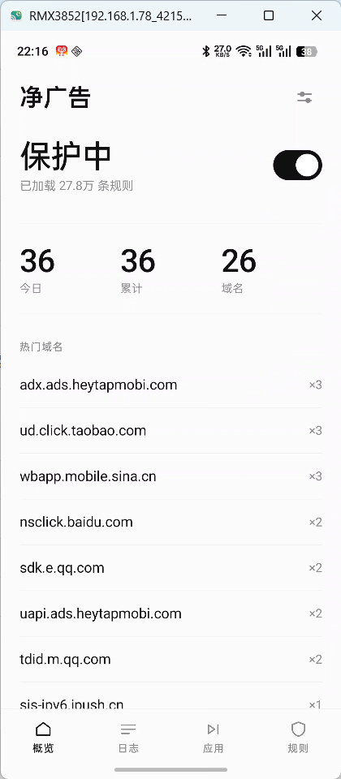
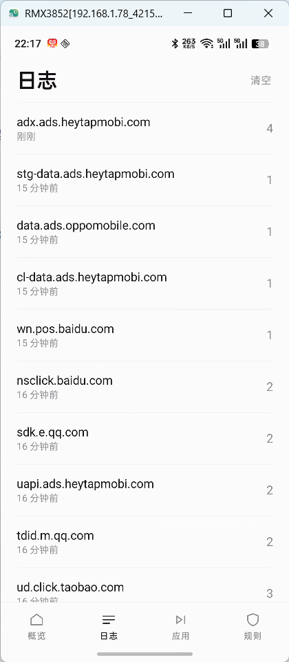
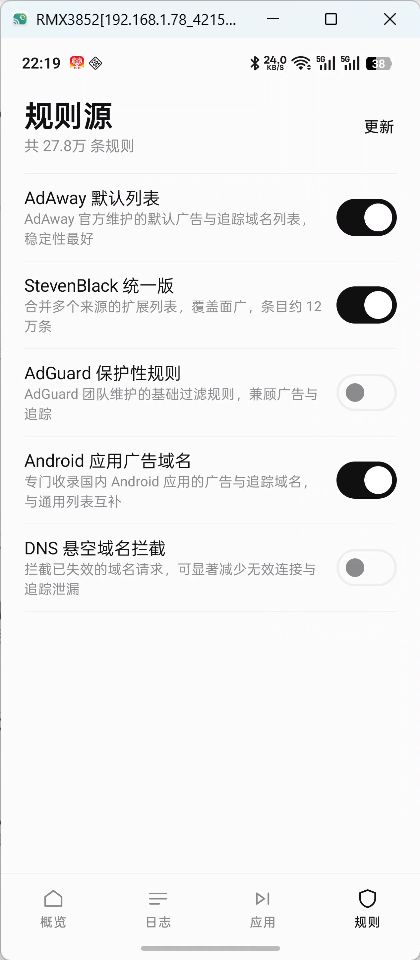
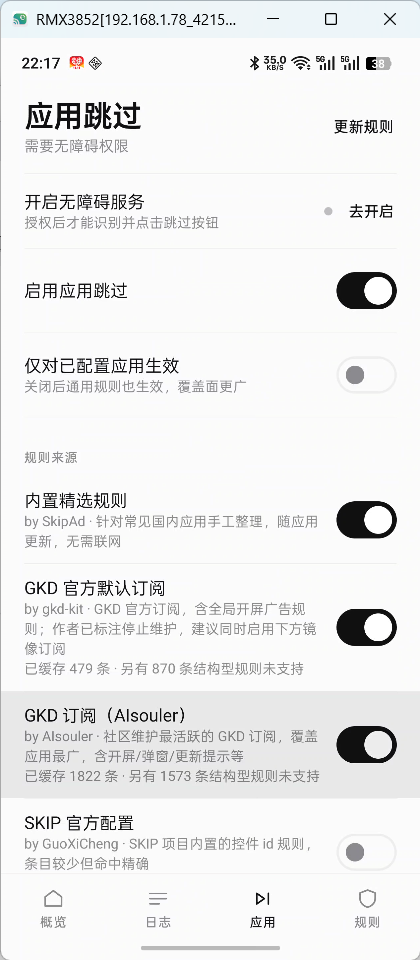
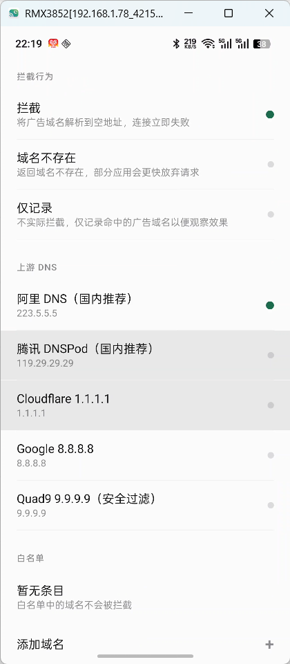
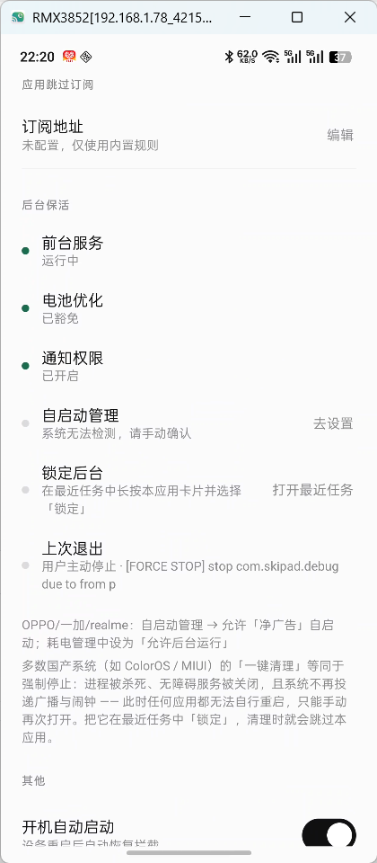

# 净广告 SkipAd

一款**纯 Kotlin** 实现的 Android 广告拦截应用，无需 Root。

采用**双引擎架构**：
- **DNS 引擎** —— 拦截网络层广告（独立域名型）
- **无障碍引擎** —— 识别并跳过本地渲染的开屏广告（参照 SKIP / Fuck-AD 的方案）

两个引擎互相补充，覆盖了单一技术路线的盲区。

---

## 零、获取与安装

| 项目 | 说明 |
|---|---|
| 仓库地址 | https://github.com/Diaojiangjun/skip-ad |
| 下载安装包 | [Releases 页面](https://github.com/Diaojiangjun/skip-ad/releases/latest) 中的 `SkipAd-1.0.0-release.apk` |
| 系统要求 | Android 8.0（API 26）及以上，**无需 Root** |
| 开源协议 | [GPL-3.0](LICENSE) |

```bash
git clone https://github.com/Diaojiangjun/skip-ad.git
```

Release 安装包使用正式密钥签名（APK 签名方案 V2），证书 SHA-256 指纹：

```
DD:06:4E:23:FF:2A:D4:E5:99:92:B4:18:F7:BA:2B:EE:07:9C:74:9A:EB:F6:CB:D2:FD:0B:F7:62:85:D3:B3:DC
```

> 不同签名来源的 APK 无法互相覆盖安装。若此前装过 Debug 包，请先卸载再安装 Release 包。

---

## 一、为什么选择纯 Kotlin 的双引擎方案

### 1.1 为什么不直接复用现有开源项目

调研 GitHub 上主流的去广告项目后，发现它们普遍存在构建门槛或技术路线局限：

| 项目 | Star | 架构 | 问题 |
|---|---|---|---|
| [blockads-android](https://github.com/pass-with-high-score/blockads-android) | 2.2k | Kotlin UI + **Go 编写的 tunnel AAR** | 1529 个文件，需 gomobile 交叉编译 |
| [Athena](https://github.com/Kin69/Athena) | 724 | Kotlin 自建完整 TCP/IP 协议栈 | 需实现 TCP 状态机，代码量大且难调试 |
| [hikari-adblock](https://github.com/codegeasse1/hikari-adblock) | 34 | Kotlin + `GoTunnelAdapter` | 仍依赖 Go tunnel |
| [rethink-app](https://github.com/celzero/rethink-app) | 5.7k | Kotlin + Go tunnel | 同上 |
| [AdAway](https://github.com/AdAway/AdAway) | 10k+ | Java | 需 Root 写 hosts 文件 |
| [GKD](https://github.com/gkd-kit/gkd) | 10k+ | Kotlin | 需无障碍权限，走 UI 自动化 |
| [SKIP](https://github.com/GuoXiCheng/SKIP) | 3.7k | Kotlin + 无障碍 | 只做开屏广告，规则靠人工录制 |
| [Fuck-AD](https://github.com/hujiayucc/Fuck-AD) | 500 | LSPosed Hook + 无障碍 | **依赖 Root/Magisk**，普通用户不可用 |

**本项目的差异化**：不实现完整 TCP/IP 协议栈，不依赖 Go/NDK，**也不依赖 Root**。

### 1.2 DNS 引擎：只接管 DNS 流量

核心洞察是 —— **网络层广告必须先解析一个广告域名**，只要让这个域名解析失败，广告就加载不出来。

因此本项目只接管 DNS 流量：

```
应用发起 DNS 查询 → 路由进 TUN → 解析域名 → 命中规则？
                                                  ├─ 是 → 返回 0.0.0.0，连接立即失败
                                                  └─ 否 → 转发到上游 DNS → 应答写回 TUN
```

VPN 配置中只对代理 DNS 地址添加路由，**其余流量（网页、视频、下载）完全走系统默认路由**，因此：

- ✅ 无需实现 TCP/IP 协议栈，代码量与出错面大幅降低
- ✅ 无 Go / NDK / 交叉编译工具链，任意机器 `./gradlew assembleDebug` 即可
- ✅ 不影响非广告流量的吞吐与延迟
- ✅ 全部逻辑可用 JVM 单元测试覆盖

### 1.3 无障碍引擎：补上 DNS 拦不住的盲区

DNS 引擎有一个无法回避的盲区：**开屏广告常与正常内容同域**，无法通过域名区分。

因此引入无障碍引擎，参照 [SKIP](https://github.com/GuoXiCheng/SKIP) 与 [Fuck-AD](https://github.com/hujiayucc/Fuck-AD) 的设计：

| 设计点 | SKIP 的做法 | Fuck-AD 的做法 | 本项目的取舍 |
|---|---|---|---|
| 匹配维度 | `skipIds`(resource-id) + `skipBounds`(坐标) | text / desc / resourceId / className + 排除项 + 区域 | **合并两者**，六维正向 + 三维排除 + 区域约束 |
| 点击方式 | `dispatchGesture` | 手势 / Shizuku / Root / `performAction` | **仅用 `dispatchGesture`** —— 免 Root、免 Shizuku |
| 去重 | `clickedRect` 集合 | 冷却 + 去重 | **位置级去重**（不含规则 id），更严格 |
| 规则来源 | 人工录制的 JSON | 内置 + 订阅 + 本地 | **内置 + 订阅 + 自定义**，兼容 GKD/SKIP 格式 |
| 误触防护 | 扫描次数上限 | 优先级 + 冷却 + 区域 | 全部采纳，并**额外提供收紧模式** |

与 Fuck-AD 不同，本项目**不使用 LSPosed Hook**，因此不需要 Root 或 Magisk，普通用户即可使用。

---

### 1.4 软件截图

|  |  |      |
| ------------------------------------------------------------ | ------------------------------------------------------------ | ---- |
|  |  |      |
|  |  |      |
|                                                              |                                                              |      |


## 二、核心架构

```
┌─────────────────────────────────────────────────────────┐
│  UI 层 (Jetpack Compose + Material 3)                   │
│  ├─ DashboardScreen   主控台：开关 / 统计 / 热门域名       │
│  ├─ LogScreen         拦截日志                             │
│  ├─ SkipScreen        应用跳过：无障碍权限 / 规则 / 订阅     │
│  ├─ FilterScreen      规则源管理                           │
│  └─ SettingsScreen    拦截模式 / 上游 DNS / 白名单 / 按应用排除 │
├─────────────────────────────────────────────────────────┤
│  服务层                                                   │
│  ├─ AdBlockVpnService       DNS 引擎：建立 TUN、路由 DNS   │
│  ├─ SkipAccessibilityService 无障碍引擎：识别并点击跳过按钮 │
│  ├─ BootReceiver            开机自启                        │
│  └─ AdBlockTileService      快捷设置磁贴                   │
├─────────────────────────────────────────────────────────┤
│  核心层 (core/) —— 纯 Kotlin，不依赖 Android 框架          │
│  ├─ dns/DnsCodec       DNS 报文编解码（压缩指针/EDNS0）     │
│  ├─ net/PacketCodec    IPv4/IPv6 + UDP 封包与校验和         │
│  ├─ blocklist/         DNS 规则解析与三级索引匹配引擎        │
│  ├─ skip/SkipRule      应用级规则模型（六维匹配 + 区域）     │
│  ├─ skip/SkipMatcher   应用级节点匹配引擎（纯逻辑可测）      │
│  ├─ skip/ClickGuard    点击去重与规则冷却                   │
│  └─ vpn/DnsTunnel      TUN 读写循环 + 上游转发             │
├─────────────────────────────────────────────────────────┤
│  数据层 (data/)                                          │
│  ├─ filter/            DNS 规则源下载、解析、本地缓存       │
│  ├─ skip/              应用级规则订阅与存储                │
│  ├─ prefs/             DataStore 设置持久化                │
│  └─ log/               SQLite 拦截日志与统计               │
└─────────────────────────────────────────────────────────┘
```

> **核心层不依赖 Android 框架**：`SkipRect` 取代 `android.graphics.Rect`，
> 节点快照 `SkipNode` 取代 `AccessibilityNodeInfo`。
> 这让全部匹配逻辑可以直接在 JVM 上单元测试，无需模拟器或 Robolectric。

### 关键实现细节

**1. 只路由 DNS 流量，且代理地址与接口地址分离**

```kotlin
builder
    .addAddress("10.111.222.1", 32)      // TUN 接口地址
    .addDnsServer("10.111.222.2")        // 代理 DNS 虚拟地址
    // 只把发往代理 DNS 的流量导入 TUN，其余流量走系统默认路由
    .addRoute("10.111.222.2", 32)
```

⚠️ 代理 DNS 地址**必须**与 TUN 接口地址分开。分配给 VPN 接口的地址会进入内核的
local 路由表，而 local 表优先级高于自定义路由 —— 若两者相同，发往代理的 DNS 查询
会被本地投递而根本不进入 TUN，拦截随之失效。`VpnConfigTest` 专门守护这一约束。

**2. 规则匹配：三级索引 + 标签逐级回溯**

对查询 `a.b.example.com`，逐级检查 `a.b.example.com` → `b.example.com` → `example.com`，
每级同时查询「精确集合」与「后缀集合」，因此**无需遍历全部规则**。

- `exactDomains` —— 精确匹配（adblock `|http://domain^`）
- `suffixDomains` —— 域名 + 子域（hosts 格式默认语义）
- `regexRules` —— 正则规则

50,000 条规则下 10,000 次匹配耗时 < 100ms（有性能测试守护）。

**3. 例外规则优先级**

`@@` 例外规则与用户白名单**优先于**所有拦截规则判定，避免误伤。

**4. 上游转发防回环**

出站 socket 必须调用 `protect()`，否则上游查询会被重新路由回 VPN 造成死循环。

**5. 线程模型**

读取线程只负责收包与判定，上游转发交由 8 线程池处理，避免单个慢速上游查询阻塞整条管道。

**6. 无障碍引擎的误触防护（关键）**

无障碍方案会**真实点击用户屏幕**，任何过宽的匹配条件都可能造成不可逆的误操作（如误点"确认支付"）。因此设置了多层防护：

| 防护 | 实现 |
|---|---|
| 无正向条件不匹配 | 规则必须至少指定一个 text/desc/resourceId/className |
| 排除优先 | `excludeText` / `excludeDesc` / `excludeResourceId` 命中即排除 |
| 区域约束 | 通用规则强制限定右上角（`TOP_RIGHT`），避免误点页面主体 |
| 越界过滤 | 零尺寸、完全离屏的节点直接跳过 |
| 位置级去重 | 同一物理位置只点击一次，**去重键不含规则 id** —— 换条规则命中同一按钮也不会二次点击 |
| 规则冷却 | 规则级冷却时间，防止高频触发 |
| 扫描上限 | 单次应用会话最多扫描 50 次，防止无限循环耗电 |
| 收紧模式 | 可开启「仅对已配置应用生效」，通配规则完全不参与匹配 |

内置规则中，每条都必须**带有 resource-id 或限定在右上角区域**，有测试守护这一约束。

---

## 三、构建与运行

### 环境要求

- JDK 17+
- Android SDK（compileSdk 35，minSdk 26 / Android 8.0）
- Gradle Wrapper 已内置，无需预装 Gradle

### 构建

```bash
# Debug 包
./gradlew :app:assembleDebug

# Release 包（启用 R8 混淆与资源压缩）
./gradlew :app:assembleRelease

# 单元测试
./gradlew :app:testDebugUnitTest
```

产物位于 `app/build/outputs/apk/`。

正式发布包使用独立 Release 密钥签名。密钥库 `release.jks` 与 `keystore.properties` 均已在
`.gitignore` 中排除，**不会进入仓库**；未配置密钥时 `assembleRelease` 仍可正常构建
（产物仅用于 CI 验证，不可作为发布包）。

```bash
# 首次发布前自行生成密钥（密码自行保管，丢失后无法再发布同签名升级包）
keytool -genkeypair -alias skipad -keyalg RSA -keysize 2048 -validity 10000 \
  -storetype PKCS12 -keystore release.jks

# 在 keystore.properties 中填写 storeFile / storePassword / keyAlias / keyPassword
./gradlew :app:assembleRelease
```

### 使用

1. 安装 APK 并打开应用
2. 首次使用会请求 VPN 授权（系统弹窗，需允许）
3. 在「规则源」页点击「立即更新全部规则源」下载规则
4. 回到主页开启保护开关 —— **DNS 引擎**开始工作
5. 如需跳过开屏广告：进入「应用」页 → 点击「前往系统设置开启」→ 找到「净广告」→ 开启无障碍服务
6. 可在系统设置中把「净广告开关」磁贴添加到快捷设置栏

### 两种拦截方式如何配合

| 广告形态 | 拦截引擎 | 说明 |
|---|---|---|
| 独立域名型广告（横幅、信息流） | DNS 引擎 | 广告域名解析失败，请求直接失败 |
| 开屏广告、启动闪屏 | 无障碍引擎 | 识别「跳过」按钮并自动点击 |
| 同域路径型广告（`/banner.jpg`） | ❌ | 两者的固有边界，需 MITM 方案才能覆盖 |

---

## 四、测试覆盖

204 个单元测试全部通过，覆盖十个层面：

| 测试类 | 数量 | 覆盖内容 |
|---|---|---|
| `DnsCodecTest` | 10 | 报文往返、压缩指针、自引用指针防死循环、EDNS0、畸形输入、拦截响应构造 |
| `PacketCodecTest` | 10 | IPv4/IPv6 解析构造、校验和正确性、IP 地址格式化（RFC 5952） |
| `RuleEngineTest` | 16 | hosts/adblock 语法解析、精确 vs 后缀语义、例外优先级、正则、5 万条规则性能 |
| `DnsInterceptionTest` | 5 | 端到端拦截链路：构造查询 → 判定 → 生成应答 → 封装回 IP 报文 |
| `VpnConfigTest` | 5 | 代理 DNS 与 TUN 接口地址必须分离等关键约束 |
| `SkipMatcherTest` | 23 | 多维匹配、排除优先、区域约束、越界过滤、优先级、收紧模式、点击坐标 |
| `SkipRuleCodecTest` | 10 | 标准/扁平/GKD/SKIP 四种格式解析、序列化往返、内置规则合法性 |
| `ClickGuardTest` | 7 | 位置级去重、规则冷却、应用切换重置 |
| `Json5Test` | 9 | JSON5 → 严格 JSON：无引号键名、单引号、注释、尾随逗号、URL 中的双斜杠 |
| `GkdSelectorTest` | 14 | 属性选择器求值、结构型选择器拒绝、`@` 目标条件提取的安全边界 |
| `GkdSubscriptionTest` | 8 | 订阅解析：全局组、应用组、禁用应用、数组形式 matches、规则 id 唯一 |
| `DnsDecisionTest` | 7 | **运行路径与测试共用同一份拦截判定**：放行/拦截/监控三态、应答构造 |
| `SettingsReadTest` | 6 | 设置读取与默认值、非法枚举回退 |
| `BuildRuleSetTest` | 6 | 规则集合并：内置规则始终生效、坏自定义规则被跳过 |
| `CollectSafelyTest` | 5 | 单源失败不影响整体 |
| `CustomDomainRulesTest` | 6 | 自定义拦截域名的规整与丢弃规则 |
| `BlockedByAppSqlTest` | 4 | 按应用归因表的建表、累加、聚合语句 |
| `DohForwarderTest` | 5 | DoH 端点判定、主机名解析、解析失败兜底 |
| `BuiltInSkipRulesTest` | 9 | 通用开屏规则的**误伤边界**：认得出广告关闭按钮，认不出普通关闭按钮 |
| `BlockLogStoreSqlTest` | 12 | **用真实 SQLite 引擎执行生产 SQL**：建表/建索引语法、计数累加、日汇总时区一致性 |
| `FilterSourceTest` | 7 | 规则源地址合法性与镜像完整性 |

测试全部为纯 JVM 单元测试，无需模拟器。

**内置规则的安全约束有测试守护**：

```kotlin
@Test
fun `内置规则均限定在右上角或含资源 ID`() {
    BuiltInSkipRules.rules.forEach { rule ->
        val hasResourceId = rule.match.resourceId.isNotEmpty()
        val regionConstrained = rule.match.region == ScreenRegion.TOP_RIGHT
        assertTrue(
            "规则 ${rule.id} 既无资源 ID 又未限定右上角区域，误触风险过高",
            hasResourceId || regionConstrained
        )
    }
}
```

---

## 五、规则源

内置 5 个可勾选的规则源，默认启用前三个：

| 规则源 | 说明 |
|---|---|
| AdAway 默认列表 | 官方维护，稳定性最好 |
| StevenBlack 统一版 | 合并多来源，覆盖面广（约 12 万条） |
| Anti-AD 移动版 | 专攻国内应用开屏广告与弹窗 |
| AdGuard 保护性规则 | 兼顾广告与追踪 |
| DNS 悬空域名 | 拦截失效域名请求，减少追踪泄漏 |

规则源支持 hosts 格式与 adblock 语法（`||domain^`、`@@` 例外、`/正则/`）。

---

## 六、真机验证记录

以下问题**全部在真实设备（Android 12 / x86_64 模拟器）上实测发现并修复**，单元测试无法覆盖：

| # | 症状 | 根因 | 修复 |
|---|---|---|---|
| 1 | **应用一启动就崩溃** | 建索引 SQL 写成 `CREATE INDEX idx_$TABLE last_seen ON ...`，`$TABLE` 展开后变成 `idx_blocked_domains last_seen`（索引名后多一个标识符），SQLite 报 `near "last_seen": syntax error`，数据库创建失败并抛 FATAL EXCEPTION | 索引名改为完整单标识符 `idx_blocked_domains_last_seen` |
| 2 | 隧道收到 0 个 DNS 查询 | 显式设置 `setBlocking(false)` 让 fd 变为非阻塞，而读取循环用的是阻塞式 `read()`，线程空转后退出 | 改为 `setBlocking(true)`，并加「连续空读」保护 |
| 3 | `tun0` 变成 DOWN，隧道失效 | `startTunnel()` 被 Activity 恢复与 `onStartCommand` **并发调用两次**，第二次 `establish()` 顶掉第一个接口，第一个 fd 立即 EOF | 用 `Mutex` 串行化隧道建立 |
| 4 | 界面显示「运行中」但实际无防护 | `protectionEnabled` 只是用户意图，进程被杀后服务已死但设置仍为 true | 界面区分「意图」与「实际运行」，启动时自动恢复服务 |
| 5 | 规则数一直显示 0 | StateFlow 初始值 `AppSettings()` 的 `enabledFilterIds` 是空集，加载了 0 条规则；且 `refreshStats` 用服务值（未运行为 0）覆盖了刚算出的值 | 一律从仓库读设置；规则数持久化，无服务时回退到持久值 |
| 6 | **「今日拦截」永远为 0** | 写入用 `timestamp / 86400000`（UTC 基准），读取用「本地零点 / 86400000」，UTC+8 时区两者错开一天 | 统一按本地零点归一化 |
| 7 | 单个规则源不可达会拖住整个更新 | 源仓库已失效（404）或大文件超时 | 每源配置多个镜像依次回退；大文件用长超时客户端 |
| 8 | **开启保护 5 秒后应用被系统杀死** | 先解析 27.8 万条规则（约 20 秒）再调用 `startForeground()`，超出前台服务 5 秒时限，抛 `ForegroundServiceDidNotStartInTimeException` | 在 `onCreate()` 中立即前台化（通知显示「正在加载规则…」），规则加载完再更新通知文案 |
| 9 | **应用跳过完全无效，一次都不触发** | 无障碍配置缺少 `android:canPerformGestures="true"`，`dispatchGesture()` 恒返回 false，点击从未真正发出 | 补上该声明，并检查返回值，为 false 时打印明确错误 |
| 10 | 可能误点其他应用窗口 | 扫描全部窗口的节点，却套用当前应用的规则 | 只扫描包名与当前应用一致的窗口 |
| 11 | 系统界面被误点（`已跳过 @ com.android.systemui`） | 全局规则（包名 `*`）套用到了通知栏/桌面等系统界面 | 系统界面只允许明确配置了包名的规则，通配规则一律不生效 |
| 12 | 服务停止后残留无法划掉的通知，系统 UI 反复报 `NameNotFoundException` | 销毁时未移除前台通知（多见于异常终止或卸载） | `onDestroy` / `onRevoke` 显式 `stopForeground(STOP_FOREGROUND_REMOVE)` + 取消通知 |
| 13 | 自身界面滑动时每 2~3 秒触发一次 20~33MB 的 GC，PSS 达 148MB | 无障碍服务把自己应用的界面也纳入扫描，每次重建上千个节点快照 | 跳过自身包名与系统界面的扫描；PSS 降至 116MB，滑动 10 次仅 2 次 GC |
| 14 | 日志刷 `OnBackInvokedCallback is not enabled` | 未声明预测性返回 | 清单加 `android:enableOnBackInvokedCallback="true"` |

**拦截效果的最终验证**（设备实测）：

```
analytics.163.com  → 127.0.0.1  （被拦截，连接必然失败）
crash.163.com      → 127.0.0.1  （被拦截）
iad.g.163.com      → 127.0.0.1  （被拦截）
www.baidu.com      → 183.2.172.177  （正常放行）
```

界面统计同步正确：今日拦截 3 / 累计 3 / 拦截域名 3 / 本次查询 5。

---

## 七、后台保活

Android 上没有「一定能活」的开关，保活是一层层叠加的结果。本项目实现了 6 层机制，
并在设置页提供自检面板逐项核对。

### 7.1 已实现的机制

| 层级 | 机制 | 作用 | 说明 |
|---|---|---|---|
| 1 | **前台服务 + 常驻通知** | 最高进程优先级 | `foregroundServiceType="specialUse"`，通知不可划掉 |
| 2 | **立即前台化** | 规避 5 秒超时杀进程 | `onCreate()` 中立刻 `startForeground()`，之后再异步加载 27 万条规则 |
| 3 | **`START_STICKY` + 重投递** | 系统内存回收后重建服务 | 但厂商 ROM 常不执行，故需第 4 层 |
| 4 | **AlarmManager 自检** | 每 15 分钟检查，服务不在就拉起 | `setAndAllowWhileIdle`，Doze 下仍可触发（实际间隔放宽至约 25 分钟） |
| 5 | **`onTaskRemoved` 快速重启** | 从最近任务划掉后 1.5 秒恢复 | 配合 `stopWithTask="false"` |
| 6 | **开机 / 覆盖安装自启** | 重启与升级后恢复 | 含 `QUICKBOOT_POWERON` 等厂商快速开机广播 |

此外还有两项**依赖用户授权**的关键前提：

- **电池优化豁免**（`REQUEST_IGNORE_BATTERY_OPTIMIZATIONS`）：首次开启保护时自动申请一次。未豁免时系统会在 Doze 下冻结应用，前台服务也会被降级。
- **厂商自启动白名单**：小米/华为/OPPO/vivo 等 ROM 有独立的自启动管理，**没有任何 API 可读写**，只能引导用户手动开启。设置页会按机型给出针对性路径，并可直接跳转到对应设置界面。

### 7.2 实测结果

在 Android 12 设备上验证：

```
kill -9 杀掉进程
  → 系统日志: Process com.skipad.debug has died: fg +50 FGS
  → 系统未自动重启（START_STICKY 在此设备未生效）
  → 触发自检广播
  → 2 秒内服务恢复，tun0 重新 UP，无崩溃
```

这个结果恰好说明为什么需要自检层：**只依赖 `START_STICKY` 是不可靠的**。

同时修复了一个隐蔽但致命的问题：早期版本在 `onCreate()` 之后才加载规则（约 20 秒），
再调用 `startForeground()`，超过系统 5 秒上限，触发
`ForegroundServiceDidNotStartInTimeException` 直接杀死进程。

### 7.3 无法做到的事

**用户在系统设置中点击「强行停止」后，任何应用都无法自动重启**（除非 root）。
Android 会把应用置为 stopped 状态，广播、闹钟、JobScheduler 全部失效，直到用户手动再次打开。
这是系统安全设计，本项目不尝试绕过，只在界面上如实说明。

### 7.4 为什么「一键清理」之后就失效了

这是国产 ROM 上最常见的困惑。以 realme（ColorOS）实测为例，在最近任务里点「清除」后：

```
ActivityManager: Killing 27176:com.skipad.debug (adj 100): stop com.skipad.debug due to o-stop(2)
dumpsys package : stopped=true
settings       : enabled_accessibility_services = null
```

三件事同时发生：

1. **进程被强制停止**（`o-stop`，adj 100 的前台服务照杀）
2. **应用进入 `stopped` 状态** —— Android 不再向其投递任何广播与闹钟
3. **无障碍服务被系统关闭** —— 应用跳过功能一并失效

`stopped=true` 是系统级状态，**只有用户主动再次打开应用才能解除**。
这不是本应用的能力问题：Android 从设计上就不允许应用在被强制停止后自行复活 ——
否则任何恶意软件都能无限驻留。所以：

- `START_STICKY`、AlarmManager 自检、`onTaskRemoved` 在这一步全部无效
- 也没有任何第三方 API 能绕过（除 root）

**可行的规避方式只有系统设置层面：**

| 措施 | ColorOS / realme 路径 | 效果 |
|---|---|---|
| **锁定后台**（最有效） | 最近任务 → 长按本应用卡片 → 「锁定」 | 清理时跳过该应用，进程不被杀 |
| 允许后台运行 | 设置 → 电池 → 应用耗电管理 → 本应用 → 允许后台运行 | 降低被回收概率 |
| 自启动 | 设置 → 应用 → 自启动 → 允许本应用 | 被杀后下次开机/触发时能恢复 |
| 通知权限 | 设置 → 通知 → 允许本应用 | 常驻通知可见，前台服务更稳定 |

应用内已提供：设置页「后台保活」面板可直接看到 **上次退出的真实原因**
（例如 `被系统清理 · stop com.skipad.debug due to o-stop(2)`），
并提供「打开最近任务」按钮直达锁定入口。

此外，Android 13+ 的通知权限默认不授予，本应用在开启保护时会主动申请 ——
没有可见通知的前台服务在多数 ROM 上优先级更低、更容易被清理。

---

## 八、界面设计

界面遵循极简原则，用**排版**建立层级，而不是用卡片和色块。

### 设计规则

| 规则 | 做法 | 反例（已移除） |
|---|---|---|
| **无卡片** | 全部内容用「发丝线 + 留白」分隔 | 每行一个带底色圆角 Card |
| **单强调色** | 只有「正常/选中」用绿色，其余全为灰阶 | 4 种主题色 + 动态取色 |
| **数字优先** | 统计用 34sp 大号字，标签用小号灰字 | 图标 + 数字 + 标题三行堆叠 |
| **一行一信息** | 主文案 15sp，副文案 13sp 灰 | 一段说明文字塞进卡片 |
| **图标统一** | 全部为 1.6dp 描边的线性图标 | 混合填充/线性图标 |
| **导航精简** | 4 个标签 + 设置从右上角进入 | 5 个标签挤在底部 |

主题刻意**关闭动态取色**：壁纸取色会让同一界面的强调色随设备变化，极简设计需要稳定的灰阶。

### 启动耗时

点开应用到「保护中」需要多久，取决于要解析多少规则。这里做过一次针对性优化：

| 阶段 | 优化前 | 优化后 | 做法 |
|---|---|---|---|
| 解析 27.8 万条规则 | 5087ms | **1278ms** | 去掉每行一次的 `split(Regex("[ \t]+"))`（逐行编译正则），改手写下标扫描 |
| 构建规则索引 | 725ms | **203ms** | 白名单与规则一次性入索引，不再 `replaceRules` + `setAllowList` 建两遍 |
| **进程启动 → 隧道就绪** | 约 6.9s | **约 2.2s** | 以上两项之和，实测 realme RMX3852 |

另外两处让等待「可感知地变短」：

- 概览页在「已开启但服务未就绪」时用 **1 秒**间隔刷新状态（稳定后回到 5 秒），
  隧道一建立界面立刻变「保护中」，不用等到下一次 5 秒轮询
- 规则解析前不再生成 27 万个中间 `Rule` 对象（原始规则快照改为惰性生成）

> 之所以仍然区分「启动中」和「保护中」：隧道没起来时查询并未被接管，
> 此时显示「保护中」是不诚实的。宁可如实等 2 秒。

### 应用名称

名称跟随系统语言，且**每一处都同源**（同一个字符串资源），避免出现「桌面叫一个名字、无障碍列表叫另一个名字」：

| 位置 | 中文系统 | 英文系统 | 来源 |
|---|---|---|---|
| 桌面图标 / 最近任务 / 应用信息 | 净广告 | SkipAd | `@string/app_name` |
| 系统设置 → 无障碍服务列表 | 净广告 | SkipAd | `@string/accessibility_service_label` |
| 快捷设置磁贴 | 净广告 | SkipAd | `@string/tile_label` |
| 系统 VPN 会话名 | 净广告 | SkipAd | `R.string.app_name` |
| 应用内页标题 | 净广告 | SkipAd | `R.string.app_name` |

中文位于默认 `values/`，英文位于 `values-en/`。默认语言取中文，因为界面文案本身是中文的；
其他语种回落到中文名，不会出现「英文名 + 中文界面」的错配。

### 首次引导

新安装后先展示一页「四步完成设置」，把必须由用户亲自授权的事项串起来，
每步都能直接跳到对应位置，不用自己找：

```
① 开启广告拦截      授权 VPN，建立本地 DNS 过滤隧道
② 允许自动跳过开屏   授权无障碍，用于点击「跳过」按钮
③ 下载跳过规则      拉取 GKD / SKIP 社区规则
④ 锁定后台          防止被一键清理杀掉
```

引导只在首次安装出现一次，完成标记写入 DataStore。
之后可在 设置 → 帮助 → 使用引导 重新查看。

### 页面结构

```
概览   大号状态 + 三个数字 + 热门域名列表
日志   纯列表，域名 / 时间 / 次数
应用   无障碍权限 + 两个开关 + 内置规则
规则   规则源开关列表 + 顶部「更新」
设置   拦截行为 / 上游 DNS / 白名单 / 按应用排除 / 订阅 / 保活 / 其他
```

---

## 九、应用跳过与规则源

### 9.1 内置规则源

「应用」页逐个列出规则来源、作者与本地缓存状态，不是一条来路不明的「订阅地址」。

| 源 | 作者 | 说明 | 默认 |
|---|---|---|---|
| 内置精选规则 | SkipAd | 手工整理，随应用更新，无需联网 | 开 |
| GKD 官方默认订阅 | gkd-kit | 含全局开屏规则；**作者已标注停止维护** | 开 |
| GKD 订阅（AIsouler） | AIsouler | 社区维护最活跃，覆盖应用最广 | 开 |
| SKIP 官方配置 | GuoXiCheng | 控件 id 规则，条目少但精确 | 关 |
| 自定义订阅地址 | 用户 | 任意 GKD / SKIP 格式 | - |

每个源配置多个镜像（jsDelivr + 官方 npm 源），单个镜像不可达时自动回退。

### 9.2 GKD 订阅的兼容范围

GKD 的选择器是 CSS 风格的节点查询语言。本引擎**只实现属性子集**，其余如实跳过：

| 语法 | 支持 | 说明 |
|---|---|---|
| `[text="跳过"]` `[text*="跳过"]` `[text^=…]` `[text$=…]` | ✅ | 文本匹配 |
| `[desc*="跳过"]` | ✅ | contentDescription，图片按钮常用 |
| `[vid="skip"]` `[id="pkg:id/x"]` | ✅ | 视图 id |
| `[childCount=0]` `[clickable=true]` `[visibleToUser=true]` | ✅ | 结构属性 |
| `[text.length<10]` `[width>100]` | ✅ | 数值比较 |
| `&&` `\|\|` `!` `()` | ✅ | 布尔组合 |
| `A > B` `A + B` `A <<n B` `@A` `(1,2)` | ⚠️ 部分 | 结构组合符需要完整节点树关系 |

对含结构组合符的选择器，会尝试**提取 `@` 目标节点的属性条件**（例如
`@ImageView[vid="obfuscated"][childCount=0] <2 LinearLayout` → `[vid="obfuscated"][childCount=0]`）。
提取有三条安全限制：目标必须含带字面量的 `text/desc/vid/id`、属性组内不得含布尔组合、
`checked` 等状态条件不可丢弃（`index` 例外，位置条件可安全忽略）。

**实测（AIsouler 订阅 v0.0.406，1.1MB）**：

```
规则总数 3395 条 → 可用 1822 条，另有 1573 条含无法安全求值的结构条件
微博       20 条
百度        4 条
中国电信     7 条
应用宝      0 条   （仅有一条依赖兄弟节点关系的规则，无法安全提取）
```

### 9.3 开屏广告为什么能跳过

订阅规则覆盖不到所有应用，所以另有一条**不依赖任何订阅**的通用规则
`universal_splash_selector`，用属性条件描述「跳过按钮」的共性：

```
[visibleToUser=true][childCount=0]
[(text.length>0&&text.length<10&&(text*="跳过"||text*="跳過"||text*="skip"||text*="Skip"))
 ||vid*="skip"||vid*="Skip"
 ||(vid*="count"&&vid*="down"&&vid!*="download")
 ||desc*="跳过"||desc*="skip"
 ||id$="tt_splash_skip_btn"]
```

关键点：**不限制屏幕区域**。原实现要求按钮在右上角（centerX ≥ 45% 且 centerY ≤ 45%），
但微博、应用宝、百度、中国电信会把跳过按钮放在左上、底部或居中，区域约束直接导致漏点。

同时修掉了三个导致「完全跳不过」的引擎缺陷：

| 缺陷 | 影响 | 修复 |
|---|---|---|
| 扫描预算按**事件次数**（50 次） | 开屏期间应用抛出大量 `CONTENT_CHANGED`，预算在按钮出现前就耗尽 | 改为**时间窗**（进入应用 20 秒内持续扫描，120ms 节流） |
| 只看 `rootInActiveWindow` | 广告 SDK 常把开屏弹在独立窗口，取不到节点 | 遍历所有可交互窗口（`flagRetrieveInteractiveWindows`） |
| 订阅规则**从未进入引擎** | 服务只加载内置规则，订阅形同虚设 | 服务改为从仓库加载「全部启用源 + 自定义」 |

实测引擎加载：`规则已加载：2319 条`。

### 9.4 无障碍点击的前提：`canPerformGestures`

这是最容易漏、且症状极隐蔽的一个配置：如果 `accessibility_service_config.xml` 里
没有声明

```xml
android:canPerformGestures="true"
```

那么 `dispatchGesture()` **永远返回 false，任何点击都不会发生**，日志里也不会有异常。
表现为「规则匹配正常、日志显示已跳过，但屏幕上什么也没发生」。

确认方式：

```bash
adb shell dumpsys accessibility | grep -A2 "应用广告跳过"
# 需要看到 capabilities 包含手势位（实测为 33 = 1 读取窗口内容 + 32 执行手势）
```

真机实测（realme RMX3852 / Android 16）：

```
微博      → 已跳过：微博 开屏广告        点击 (1113,278)
中国电信   → 已跳过：中国电信 开屏广告     点击 (1097,2563)
应用宝    → 本次冷启动未展示开屏广告，直接进入主界面（无广告可跳）
百度      → 设备未安装
```

---

### 9.5 无障碍服务「无法运行」的成因与修复

系统设置 → 无障碍 → 已下载的应用 里，本应用可能显示 **「无法运行。点按即可查看相关信息。」**
而不是其他应用的「已关闭」。这两者不是一回事：

| 显示 | 含义 | 能否自愈 |
|---|---|---|
| 已关闭 | 用户没开 | 用户开启即可 |
| **无法运行** | 系统把它记进了 `Crashed services`，**不再自动重新绑定** | 只能重新授权一次 |

排查命令：

```bash
adb shell dumpsys accessibility | grep -E "Bound services|Crashed services"
# 正常: Bound services:{Service[label=净广告 ...]}   Crashed services:{}
# 异常: Bound services:{}                          Crashed services:{{com.skipad.debug/...}}
```

#### 根因：进程一死，系统就判它「崩溃」

真机对照实验（realme RMX3852 / Android 16）：

| 操作 | 结果 |
|---|---|
| `am force-stop` | 设置项被清空 → 变成「已关闭」 |
| 杀进程（单进程架构） | `Crashed services` 非空，**重新打开应用也不会重绑** |
| 杀进程（独立进程架构） | 主进程被杀时无障碍存活；但杀无障碍所在进程同样进 `Crashed services` |

也就是说：**只要无障碍服务所在进程被回收，系统就把它记为崩溃**，
之后无论应用怎么重启进程，系统都不会再自动绑定它 —— 这是 Android 的设计，应用绕不过去。

由此还得出一个反直觉的结论：**把无障碍服务拆到独立进程并不能解决问题**。
主进程确实更安全（界面或 VPN 崩溃不再影响跳过），但无障碍所在进程会失去前台服务的
优先级保护，反而更容易被回收 —— 那才是用户真正遇到的问题。
实测确认后已撤回该方案，保持单进程 + 前台服务保活。

#### 应用能做的三件事

1. **降低进程被回收的概率**：VPN 前台服务常驻、电池优化豁免、最近任务里「锁定后台」。
   「应用」页在检测到服务未连接时，会直接给出「锁定后台可避免再次发生 → 去锁定」。
2. **一键尝试自动恢复**：点「修复」→ 触发一次保活自检（用显式 Intent 广播，
   避免 Android 8+ 的隐式广播限制）→ 复查连接状态。部分「暂时未连接」能自愈。
3. **把手动操作缩到一次点击**：自动恢复失败时直达系统无障碍列表。
   实测 ColorOS 会弹出「要关闭『净广告』吗？」，此时选 **「保持开启状态」** 即可恢复 ——
   **不需要先关再开**，比原来的两步少一半操作。

#### 顺带修掉的数据丢失缺陷

数据库升级原本是「全部 DROP 再重建」，每次升级都会清空用户的拦截历史，
现在改为**只补建缺失的表**。

#### 其它异常来源与处理

| 路径 | 问题 | 处理 |
|---|---|---|
| `loadRules()` 协程 | `launch` 里没有兜底，异常直接冒到默认处理器 → 进程崩溃 | 加 `CoroutineExceptionHandler` + 整段 `runCatching`，失败退回内置规则 |
| `onAccessibilityEvent` | 只有「扫描段落」包了 try，前置代码（取包名、收集窗口）没包 | 整个回调包一层 `try/catch (Throwable)` |
| 订阅规则解析 | `loadAll` 直接 `load(source)`，单个源损坏会让整次加载抛异常 | 每个源独立 `runCatching`，坏源跳过、其余照常 |
| **设置存储损坏** | DataStore 文件写坏后，**每次读取**都抛 `CorruptionException`，应用反复崩 | 加 `ReplaceFileCorruptionHandler`，损坏时重置为空配置而不是崩溃 |

最近一次异常会落盘到 `files/last_crash.txt`（含时间、场景、类型、堆栈），
「应用」页会显示上次异常的类型。

实测验证（realme RMX3852 / Android 16）：

```
① 注入一次异常
   → dumpsys: Bound services:{}  Crashed services:{{com.skipad.debug/...}}
   → 应用页显示「无障碍服务未连接」+「上次异常：进程崩溃（main）· IllegalStateException」

② 把订阅缓存改成 57 字节畸形内容
   → 规则已加载：517 条（官方 479 + SKIP 31 + 内置），无崩溃、服务保持绑定

③ 把设置文件写成 64 字节随机数据
   → 自动重置为默认配置并正常进入引导页，无崩溃

④ 杀掉进程制造 crashed 状态后重新打开应用
   → 服务确实不会自动重绑（与预期一致）
   → 点「修复」→ 自动尝试无效 → 直达系统无障碍列表
   → 选「保持开启状态」→ 服务立即重新绑定，crashed 记录被清除 ✅
```

> 说明：第 ① 步的注入代码是临时的，验证完已删除。


## 十、已知限制

### DNS 引擎

1. **不拦截 HTTPS 页面内的元素级广告**。DNS 层面只能拦截独立域名广告，无法过滤同一域名下 `/banner.jpg` 这类路径型广告。这是纯 DNS 方案的固有边界。
2. **超大 DNS 应答走 TCP 时不拦截**。Android 系统 DNS 解析器在应答超过 512 字节时会回退到 TCP 重试，该路径当前直接放行。
3. **设备开启「私人 DNS（DoT）」时，本应用可能完全收不到查询**。此时系统直接向 DoT 服务器解析，不经过 VPN 的 DNS 服务器设置 —— 这是系统行为，本应用无法介入。
   （本应用自己提供的 **DoH 上游**解决的是另一个问题：避免明文 DNS 查询被沿途设备看到。）
4. **规则正则上限 5000 条**，超出部分会被忽略，防止病态规则拖慢匹配。

### 无障碍引擎

5. **依赖无障碍权限**。用户需在系统设置中手动开启，这是 Android 的安全设计，无法绕过。
6. **无法覆盖非按钮形态的广告**。仅能点击可识别的「跳过」控件，纯图片广告、视频广告无能为力。
7. **存在理论误触可能**。虽然已实现多层防护（排除优先、区域约束、位置级去重、冷却、收紧模式），但无障碍方案本质上是在真实屏幕上点击。建议敏感用户开启「仅对已配置应用生效」。
8. **规则覆盖率依赖社区**。内置规则只覆盖常见应用，其余需通过订阅源补充。
9. **不做 UI 元素隐藏**。与 GKD 那种「删除广告控件」的做法不同，本项目只做「点击跳过」，不会修改目标应用的界面结构。
   原因很直接：隐藏别的应用的控件需要拿到目标应用的 View 实例，免 Root 做不到（必须靠 hook 或 root）。
10. **按应用的拦截统计是近似值**。Android 不提供「这次 DNS 查询由哪个 App 发起」的接口，
   本应用按「拦截发生时处于前台的应用」归因，后台应用自己的请求可能被记到前台应用头上。

---

## 十一、已实现的功能补充

### 11.1 域名查询

规则页顶部新增「查询域名」入口，输入域名立刻得到答案：

```
ads.example.com 会被拦截（命中：AdAway 默认列表、StevenBlack 统一版）
www.baidu.com 不会被拦截
example.com 在白名单中，不会被拦截
```

- 判定优先使用**运行中隧道的引擎**，毫秒级返回
- 隧道未启动时在后台临时建一份索引（约一两秒），界面上显示「查询中…」
- 来源追查走缓存文本的子串匹配，比重新解析整份规则快得多

### 11.2 自定义拦截域名

设置页新增「自定义拦截」区，可手动添加/移除要拦截的域名：

- 语义与 hosts 规则一致：**同时覆盖该域名及其所有子域**
- 变更后调用 `reloadEngine()` **热替换索引**，不重建隧道 —— 重建会造成几秒的防护空窗
- 非法域名（不含点、含非法字符）在转换阶段直接丢弃，不影响其他条目
- **回读确认**：添加后不是简单提示「已添加」，而是等索引替换完成，
  用运行中的引擎实际查一次这个域名，直接告诉用户「已确认生效」还是「当前未生效」；
  列表里也会持续显示每个域名的实时状态（绿点 = 正在被拦）

### 11.2.1 本项目覆盖不到的部分

去广告分两个层级，本项目只负责其中一层：

| 层级 | 内容 | 本项目 | 需要什么 |
|---|---|---|---|
| **网络层** | 独立域名广告、追踪域名、开屏广告的「跳过」按钮 | ✅ 覆盖 | 无障碍 + VPN 权限 |
| **系统层** | 厂商 ROM 内置的个性化广告推荐、下拉热榜、负一屏资讯、应用商店推广位、厂商营销推送、广告组件包（`com.opos.ads` 之类）、快应用 | ❌ 覆盖不了 | 电脑 + ADB |

系统层这些东西在系统设置的开关里，**手机 App 没有权限去改** ——
拨开关需要 `WRITE_SECURE_SETTINGS`，挂起广告包需要 shell 权限，普通应用都拿不到。
所以这类清理只能用电脑端的 ADB 工具来做（例如
[`rddmwmddr/android-ad-cleaner`](https://github.com/rddmwmddr/android-ad-cleaner) 这类项目），
两者是**互补**关系：先关掉系统层的推广位，再用本项目处理网络广告与开屏广告。

从那个项目的实现里借鉴了两条工程做法：

1. **回读确认**：改完不能只提示「已完成」，要回读实际状态确认真的生效。
   本项目的「自定义拦截域名」现在就是这么做的。
2. **区分开关的语义方向**：像「防止广告跟踪」「限制个性化推荐」这类开关是**保护**类，
   打开才是对的，不能当成广告开关去关。本项目的通用规则只匹配
   「跳过 / 跳過 / skip / 关闭广告 / 跳过广告」以及
   `splash_close`、`ad_close`、`close_ad`、`skip_ad` 这类明确的广告控件 id，
   不会命中「防止 / 拦截 / 屏蔽广告」这类文案，也刻意不匹配泛化的 `close` ——
   那是普通功能按钮，误伤代价太大。

### 11.3 按应用归因的拦截统计

日志页新增「按应用」区：

- 无障碍服务持续记录当前**前台应用包名**（桌面、系统界面、本应用自身不算）
- DNS 拦截落库时，按「拦截发生的那一刻的前台应用」分组写入 `blocked_by_app` 表
- 界面显示应用名、涉及域名数与拦截次数

> **这是近似统计**：Android 不提供「哪个 App 发起了这次 DNS 查询」的接口。
> 后台应用自己发起的请求可能被记到当时在前台的应用头上。
> 未授权无障碍时无法归因，此时只统计域名维度。

顺带修掉一个数据丢失缺陷：数据库升级原本是「全部 DROP 再重建」，每次升级都会清空用户的拦截历史，
现在改为**只补建缺失的表**。

### 11.4 DoH（加密 DNS）上游

设置页「上游 DNS」新增三个加密端点：

| 端点 | 说明 |
|---|---|
| `https://dns.alidns.com/dns-query` | 阿里 DNS（加密） |
| `https://doh.pub/dns-query` | 腾讯 DNSPod（加密） |
| `https://cloudflare-dns.com/dns-query` | Cloudflare（加密） |

实现要点（RFC 8484）：

- 请求体是原始 DNS 查询报文（`application/dns-message`），响应体是原始应答报文，
  与明文 UDP 完全一致，隧道代码无需改动
- **必须避开回环**：DoH 端点本身是域名，解析它需要 DNS，而本应用的 DNS 代理就是隧道。
  因此端点主机名在**建立隧道之前**（系统 DNS 仍正常时）预解析好，之后用固定 IP 直连，
  TLS 的 SNI 与证书校验仍按域名走

### 11.5 静默通知

原先设置页的「显示运行通知」开关**是无效的**：`showNotification` 只在设置里存取，服务端从不读它。
而 Android 强制要求前台服务必须有一条通知，用户根本关不掉 —— 界面在骗人。

现在改为「静默通知」：关闭时使用 `IMPORTANCE_MIN` 渠道、不显示时间、不响铃、锁屏不露出内容。
开关本身的语义也如实写进了界面。

### 11.6 持续集成

新增 `.github/workflows/ci.yml`：push / PR 触发，运行单元测试 + lint + Debug/Release 构建，
并把 APK 与测试报告作为产物上传。

### 11.7 测试覆盖到真实运行路径

原先 `DnsInterceptionTest` 在测试里**自己复写了一份**拦截判定逻辑，
测试全绿却没覆盖真正跑的代码。现在判定逻辑抽到 `DnsDecision`，
运行路径与测试共用同一份实现，并删除了从未被使用的 `DnsInterceptor` 类。

同样地，`readSettings` / `buildRuleSet` / `collectSafely` / `customDomainRules` 也都抽成了
可独立单测的纯函数 —— 这些正是历史 bug 的集中区。

---

## 十二、后续可改进项

### 已知缺陷

| 项 | 现状 | 建议 |
|---|---|---|
| **日志表无上限** | `blocked_domains` 每个新域名一行，只按 30 天清理，长期使用会持续增长 | 加条数上限或按 LRU 清理 |
| **两个死字段** | `skipSubscriptionEnabled`、`autoUpdateEnabled` 在设置里存取但无任何使用处 | 删除；「规则自动更新」要麼实现要么别留字段 |

### 功能补强

| 项 | 价值 | 难度 |
|---|---|---|
| **按应用的精确归因** | 现在是「前台应用」近似归因，后台应用的流量会记错 | 免 Root 无法精确实现；可行做法是逐应用建隔离隧道做诊断，开销大 |
| **广告控件隐藏** | GKD 能把广告控件直接隐藏，覆盖非按钮形态的广告 | **免 Root 做不到**：隐藏需要拿到目标应用的 View 实例，必须靠 hook 或 root；只能继续走「点击关闭」的路子 |
| **全量国际化** | 目前只有应用名做了中英，界面文案仍全中文 | 工作量大但机械，可分批做 |

### 长期方向（不建议现在动）

- 无障碍引擎对**图片广告、视频广告**依然无能为力（只能点可识别的控件）
- 上游 DoT（853 端口）：DoH 已覆盖大部分「加密解析」需求，DoT 收益有限

---

## 十三、项目结构

```
app/src/main/java/com/skipad/
├── SkipAdApp.kt                 应用入口
├── core/                        纯 Kotlin 核心层（不依赖 Android 框架）
│   ├── blocklist/               DNS 规则解析与匹配引擎
│   ├── dns/                     DNS 报文编解码
│   ├── net/                     IP/UDP 封包
│   ├── skip/                    应用级规则模型、匹配引擎、点击去重
│   └── vpn/                     隧道与拦截器
├── data/
│   ├── filter/                  DNS 规则源
│   ├── skip/                    应用级规则订阅与存储
│   ├── log/                     日志存储
│   └── prefs/                   设置
├── service/
│   ├── AdBlockVpnService        DNS 引擎服务
│   ├── SkipAccessibilityService 无障碍引擎服务
│   ├── BootReceiver             开机自启
│   └── AdBlockTileService       快捷设置磁贴
└── ui/                          Compose 界面
```
